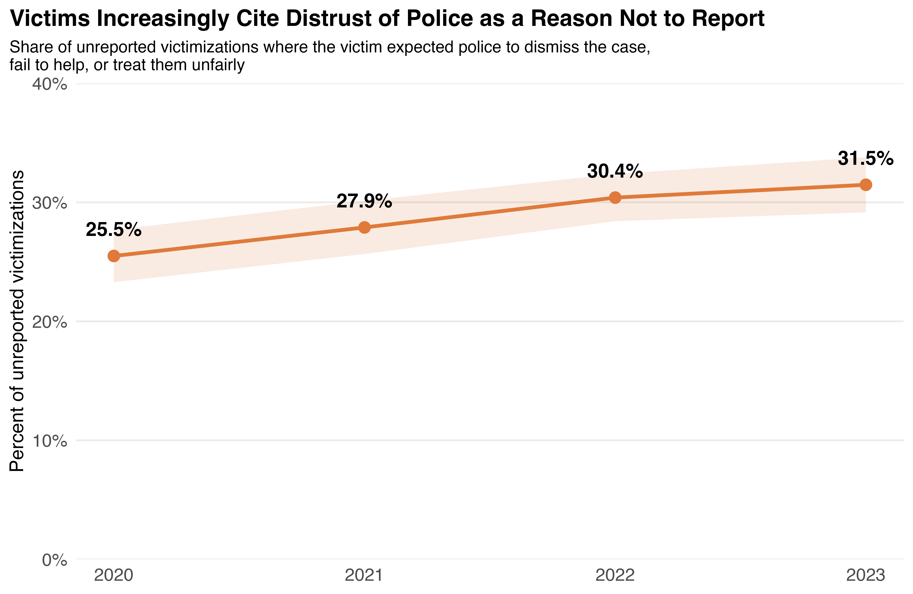
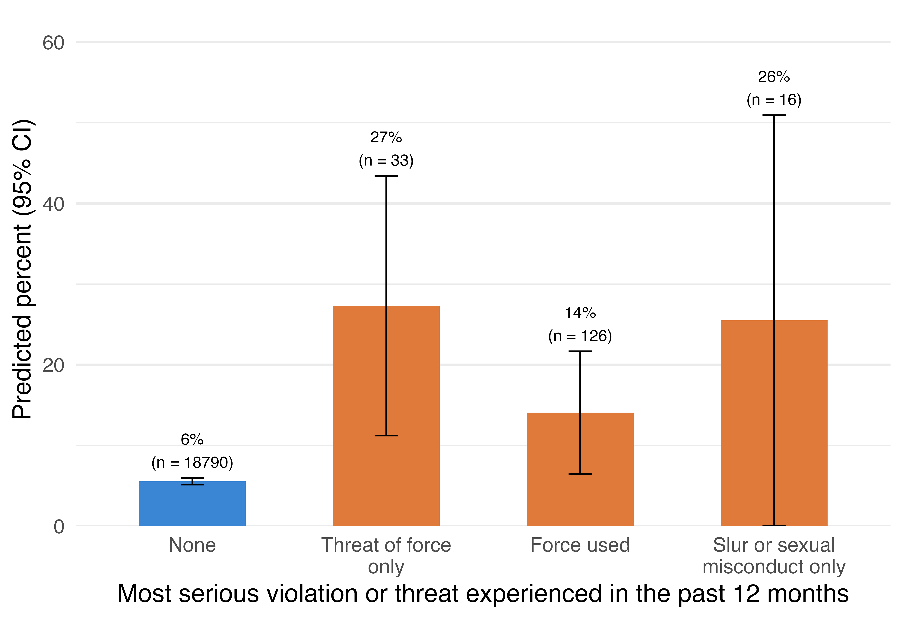

Dilruba Tas · [Full analysis and code on GitHub](https://github.com/dilrubatas/crime-reporting-ncvs-ppcs)

65%

of victimizations were never reported to police

11.5M

unreported victimizations per year, on average

29%

of unreported victimizations involved distrust of police

25→32%

rise in that share, 2020 to 2023

## 1. Most crime never reaches the police

From 2020 to 2023, **65% of victimizations** (95% CI 64–66%) went unreported. That's about 11.5 million a year. The share was steady across all four years.

Reporting depends heavily on the crime. **Motor vehicle theft** goes unreported only 23% of the time. The top reason victims give for reporting it is getting help or recovering losses. **Rape and sexual assault** (72%) and **other theft** (73%) are the least reported. The differences between crime types are statistically significant.

{fig-alt="Dot plot of the percent of victimizations not reported to police by crime type, with 95 percent confidence intervals, ranging from 23 percent for motor vehicle theft to 73 percent for other theft."}

## 2. Distrust of police is a major reason, and a growing one

When victims explained their decision, the most common main reason was that the crime **wasn't important enough** (29% of unreported victimizations). Next came **police-related reasons** (24%).

Victims could name more than one reason. In **29% of unreported victimizations**, the victim expected police to dismiss the case, fail to help, or treat them unfairly. That's roughly **3.3 million victimizations a year**. By far the most common expectation was that police wouldn't think the case was important (23%).

The combined share rose every year, from **25.5% in 2020 to 31.5% in 2023**. The 2020 and 2023 confidence intervals don't overlap.

{fig-alt="Line chart showing the share of unreported victimizations citing police-related reasons rising from 25.5 percent in 2020 to 31.5 percent in 2023."}

## 3. Bad police encounters are linked to less willingness to call again

The Police-Public Contact Survey asked people who had contacted police themselves whether they'd be more or less likely to do so again. Among people with **no police violation or threat** in the past year, the model predicts about 6% would say they were less likely. Among those who experienced **force, a threat of force, a slur, or sexual misconduct**, that rose by about **12 percentage points** (95% CI 6–19), after adjusting for sex, age, race and ethnicity, income, and year.

{fig-alt="Bar chart of predicted percent less likely to contact police: 6 percent with no violation, 27 percent after a threat of force, 14 percent after force, and 26 percent after a slur or sexual misconduct, with wide confidence intervals for the violation groups."}

Violations are rare (about 1% of respondents), so estimates for each type are imprecise. The data are cross-sectional, so this is an association, not proof of cause.

## About the data

- **NCVS** (Bureau of Justice Statistics, via ICPSR): 35,181 victimizations from 2020–2023, weighted for series crimes. Standard errors account for the survey design. Incidents outside the U.S. and "don't know" responses are excluded.
- **PPCS** 2020 and 2022: 18,965 residents age 16+ whose most recent police contact they initiated. Estimates come from survey-weighted logistic regression.

Code, tables, and robustness checks are in the [GitHub repository](https://github.com/dilrubatas/crime-reporting-ncvs-ppcs).
